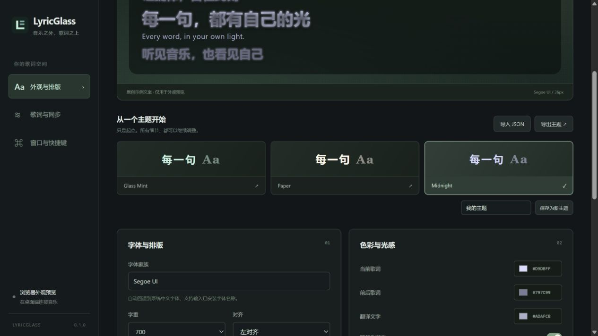

# 验收记录 · 2026-09-28

## 当前结论

代码、自动化测试、真实 LRCLIB 请求及 Windows NSIS 打包已实现。**原 prompt 的完整验收条件尚未全部达成**：本机网易云只发布部分 SMTC 元数据，缺少可靠播放时间轴；本机未发现 Spotify Desktop，无法声明已完成 Spotify 实机验证。

不会把测试会话、模拟曲目或浏览器外观预览算作真实播放器兼容性验证。

## 通过的验证

开发环境：Windows x64、Node.js 24.16.0、Rust 1.96.0、Tauri 2.12.0。

| 项目 | 实际结果 |
| --- | --- |
| `npm test` | 5 项前端测试、20 项 Rust 测试通过；无失败/忽略；Rust doc-tests 通过 |
| `npm run check` | TypeScript 类型检查、Clippy `--all-targets -- -D warnings` 通过 |
| `npm run build` | 生产前端、Windows Release 原生程序、NSIS x64 安装包构建成功 |
| npm 依赖审计 | 0 项已知漏洞；Vitest 已升级至修复版本 4.1.11 |
| 真实 LRCLIB | 公共文档示例曲目返回 `Synced`、47 行、匹配评分 1.0；没有打包歌词正文 |
| 合成 Windows 媒体会话集成测试 | **真实 Windows SMTC API** → 标准化元数据 → **真实 LRCLIB HTTPS**；暂停位置冻结、恢复、权威 seek 校正均通过 |
| 原生窗口 | 设置窗口和独立透明置顶歌词窗口已实际启动；通过实际窗口检查发现并修复首次启动状态初始化竞态 |
| 设置与主题 | 实际界面切换 Glass Mint/Midnight，核对字重、字号、对齐、颜色、渐变、显示行数即时变化；原生设置文件实际写入 |
| 默认快捷键 | 发现网易云默认键位冲突；调整为 Ctrl+Alt+Shift 组合，并测试旧默认组合迁移、自定义绑定不被覆盖 |

测试覆盖：普通/多时间戳/增强 LRC、YRC、CJK/UTF-8、重复时间戳、翻译、坏数据、空歌词、纯音乐、保守匹配、规范化与稳定键、单调时间外推、暂停/seek/切歌、多会话仲裁、provider 失败回退、本地覆盖、正负缓存及过期、损坏缓存、设置恢复与主题输入校验。

## 真实播放器矩阵

| 播放器 | SMTC 实测 | 同步歌词实测 |
| --- | --- | --- |
| 网易云音乐 3.1.41 x64（Build 205529） | 用户开启「设置 → 系统 → 开启 SMTC」后，成功检测 `cloudmusic.exe`、标题、艺人、Playing 状态及切歌变化 | **未通过完整同步**。多次采样专辑为空、duration=0、position=0，没有可靠时间轴；界面明确提示并停用时间外推 |
| Spotify Desktop | 本机没有发现可测试的安装/会话 | **未验证**；走同一标准 SMTC 适配器，不需要 OAuth |
| Microsoft Edge | 系统枚举中观察到会话及非零时间轴 | 没有做完整歌词与播放器兼容性验收 |
| QQ 音乐 / Apple Music / YouTube Music | 未验证 | 未验证 |

当前实现不会绕过网易云限制、抓取音频或读取登录凭证，也不会把从应用启动开始累计的时间当作真实播放进度。对于不提供时间轴的会话，本地同步歌词以静态全文显示。仅有曲名和艺人、没有专辑/时长时，自动匹配会保守拒绝。

## 复现 SMTC 集成测试

这是专门的测试辅助程序，**不播放音频**，不进入正式应用的数据来源。避免测试时同时重新编译正在运行的 Windows EXE。

```powershell
# 先编译
cargo build --manifest-path src-tauri/Cargo.toml --example smtc_integration

# 终端 A：先启动观察器（75 秒内等待测试会话）
.\src-tauri\target\debug\examples\smtc_integration.exe

# 终端 B：紧接着发布 60 秒的测试会话
powershell.exe -NoProfile -File tools/smtc-fixture.ps1 -Seconds 60
```

预期输出：

```text
SMTC → normalized metadata → LRCLIB: synced, 47 lines, confidence 1
Pause: frozen authoritative position
Resume: playing again
Seek: authoritative position correction
PASS: native SMTC, network resolution, pause, resume and seek
```

测试会话结束会禁用并释放其 SMTC 对象。真实网易云/Spotify 的暂停、seek、长时漂移、多播放器竞争、显示器 DPI、休眠唤醒和安装/卸载仍需扩大实机验收。本次没有运行安装程序，也没有声称安装流程、全部托盘操作和全部快捷键均做过人工验收。

## 后续优先级

1. 获得网易云缺失的可靠播放时间轴：比较播放器版本/系统会话行为；必要时研究可关闭的独立补充适配器。
2. 完成 Spotify Desktop 实机回归，扩大 NetEase 与其他播放器矩阵。
3. 在前两项解决后，验证网易云在线歌曲身份与可用接口，接入可选 YRC provider。当前仅有本地 YRC 与独立数据转换边界。

## 界面预览

以下为真实浏览器渲染的外观设置页面，使用明确标注的原创预览文案，不代表真实播放器同步。


